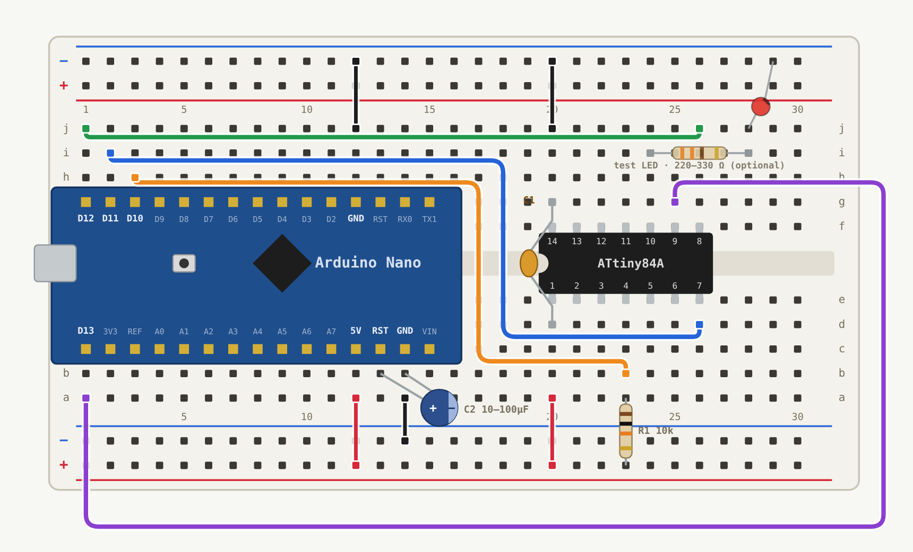

# attiny-isp-breadboard

A permanent ATtiny84A programmer on a half-size breadboard, built around an Arduino Nano running *ArduinoISP*. Nano and ATtiny sit in the same breadboard, connected by short jumpers. No loose cables, no soldering. Build it once and then you just swap chips.

Used to flash the chips for [ATinyCrawl](https://github.com/rolandkohn/ATinyCrawl), tested over many flash cycles.

Interactive version with signal highlighting and the full check guide: [`docs/index.html`](docs/index.html).

> [!WARNING]
> **Check your power rails before plugging anything in.** On the breadboard used here both rail pairs run **− on top, + below** (top pair: − outer, + inner; bottom pair: − inner, + outer). Many breadboards have them the other way round. Go by the red/blue lines on *your* board and mirror the 5V/GND jumpers if needed, otherwise 5V ends up on GND. Long breadboards often split the rails in the middle, too.

Holes are named row a–j plus column 1–30. **Row j is at the top, a at the bottom**, as printed on the breadboard used here. If yours is labelled the other way round, go by the picture.

## Parts

| Part | Where |
|---|---|
| Arduino Nano | columns 1–15, USB to the left |
| ATtiny84A | notch to the left, pin 1 on e20 (pins 1–7: e20–e26, pins 14–8: f20–f26) |
| R1 10 kΩ | a23 → bottom + rail (reset pull-up) |
| C1 100 nF | g20 (pin 14, GND) ↔ d20 (pin 1, VCC), legs bent over the chip end |
| C2 10–100 µF electrolytic | + in b13 (Nano RST), − in b14 (Nano GND). Stays in permanently |
| Test LED + 220–330 Ω (optional) | resistor i24 → i28, LED anode j28, cathode → top − rail |

## Jumpers

| Nano | From → To | ATtiny |
|---|---|---|
| D12 | j1 → j26 | pin 8 · MISO |
| D11 | i2 → d26 | pin 7 · MOSI |
| D10 | h3 → b23 | pin 4 · RESET |
| D13 | a1 → g25 (around the outside) | pin 9 · SCK |
| 5V | a12 → bottom + rail | feeds pin 1 via a20 |
| — | a20 → bottom + rail | pin 1 · VCC |
| GND | j12 → top − rail | feeds pin 14 via j20 |
| — | j20 → top − rail | pin 14 · GND |
| GND | a14 → bottom − rail | optional, currently unused |

The pinout assumes a standard Nano. Compare with the labels on your board before plugging in.

## Steps

1. **Prepare the Nano once**, outside the breadboard, USB only: upload *File → Examples → 11.ArduinoISP → ArduinoISP*. Clones with a CH340 usually need processor `ATmega328P (Old Bootloader)`.
2. **Populate the breadboard**: ATtiny, jumpers, R1, C1, C2.
3. **Plug in the Nano** and connect USB. From now on the breadboard is a dedicated programmer.
4. **Flash the ATtiny** with [ATTinyCore](https://github.com/SpenceKonde/ATTinyCore):

   | Setting | Value |
   |---|---|
   | Board | ATtiny24/44/84(a) (No bootloader) |
   | Chip | ATtiny84(a) |
   | Clock | 8 MHz (internal) |
   | Programmer | Arduino as ISP |

   For every new chip run **Burn Bootloader** once (sets the fuses), then **Sketch → Upload Using Programmer**.

To reflash the Nano itself, pull it out of the breadboard first. With C2 in the circuit its own upload fails.

## Checks

Enable *File → Preferences → Show verbose output during: upload* so the IDE shows the avrdude messages.

**Burn Bootloader** reads the chip signature:

| Output | Meaning |
|---|---|
| `0x1e930c` | All good, ATtiny84A found |
| `0x000000` | Chip does not answer: check jumpers, 5V/GND and RESET (D10 → b23) |
| `0xffffff` | Usually MISO (j1 → j26) in the wrong hole or a loose contact |
| `not in sync` | Nano problem: ArduinoISP missing, C2 missing or wrong COM port |

**Blink test** with [`firmware/blink_pa3`](firmware/blink_pa3/blink_pa3.ino) and the test LED on pin 10 (PA3):

| LED | Meaning |
|---|---|
| 1 s per cycle | Sketch runs, fuses set to 8 MHz |
| 8 s per cycle | Burn Bootloader skipped, chip runs at the factory 1 MHz |
| dark | Sketch not running or LED reversed |

PA3 is not an ISP pin, so the LED can stay plugged in while flashing.

## Licence

[MIT](LICENSE)
